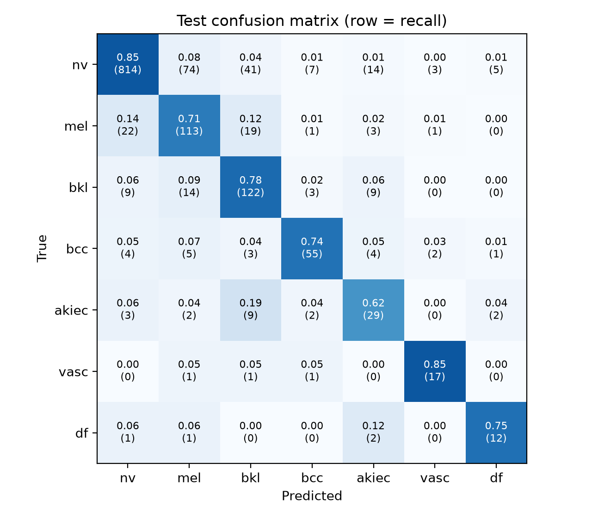
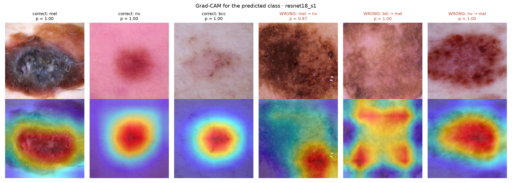

# Skin lesion classification (HAM10000)

Final project for the Deep Learning course at Tel Aviv University (2026b), Nitai Dobrecki.

The task is to classify a dermatoscopic image into one of 7 lesion types. I wanted to answer two questions:

1. How good can a model that trains on a laptop get?
2. Can we trust the number? HAM10000 has several photos of the same lesion, and splitting the data by photo instead of by lesion is a common mistake. I measured how much it inflates the results.

## Results

Balanced accuracy on the test set (1,431 images, no lesion shared with training). Mean ± std over 3 seeds where there are 3.

| Model | Balanced acc. | Melanoma recall |
|---|---|---|
| Always predict "nv" | 0.143 | 0.00 |
| Small CNN, from scratch (1 seed) | 0.504 | 0.56 |
| ResNet-18, from scratch (1 seed) | 0.575 | 0.62 |
| **ResNet-18, ImageNet pretrained** | **0.730 ± 0.042** | **0.753 ± 0.044** |
| ResNet-18 pretrained, split by image (leaky) | 0.838 ± 0.007 | 0.767 ± 0.023 |

Inside the leaky test set, images of lesions that were also in training get 0.873, new lesions get 0.798 (melanoma recall 0.85 vs 0.60). So the extra points come from the model remembering lesions it already saw.

Ablation (pretrained ResNet-18, removing one thing at a time, 3 seeds each):

| Removed | Balanced acc. | Δ | Melanoma recall |
|---|---|---|---|
| augmentation | 0.663 ± 0.039 | −6.7 | 0.633 |
| class weights | 0.698 ± 0.038 | −3.2 | 0.551 |
| weight decay | 0.744 ± 0.033 | +1.4 | 0.652 |
| dropout | 0.755 ± 0.012 | +2.5 | 0.696 |
| early stopping | 0.766 ± 0.014 | +3.6 | 0.715 |

Early stopping turned out to hurt: the validation set is small (16 dermatofibroma images), so a random dip stopped some runs around epoch 11. The epoch a run stopped at correlates with its test score (r = 0.87).




## Setup

```bash
python3.12 -m venv .venv
source .venv/bin/activate
pip install -r requirements.txt
```

Download HAM10000 from [Kaggle](https://www.kaggle.com/datasets/kmader/skin-cancer-mnist-ham10000) (or [Harvard Dataverse](https://doi.org/10.7910/DVN/DBW86T)) into `data/raw/`. The browser download kept getting cut off for me, kagglehub worked:

```bash
pip install kagglehub
python -c "import kagglehub; print(kagglehub.dataset_download('kmader/skin-cancer-mnist-ham10000'))"
mkdir -p data/raw && cp -R <path it prints>/. data/raw/
```

## Running

Everything runs from the repo root.

```bash
python src/prepare_data.py              # resize images, ~2 min
python src/splits.py                    # lesion split + leaky image split
python src/train.py --overfit 20        # sanity check, should print PASS
./scripts/run_all.sh                    # all 23 training runs, ~6 h on an M4
python src/summarize.py                 # results table -> results/
python src/leakage_analysis.py          # seen vs unseen lesions
python src/interpret.py --run resnet18_s1   # confusion matrix + Grad-CAM
python src/predict.py some_image.jpg        # demo on one image
```

A single run: `python src/train.py --model resnet18 --seed 0 --name my_run`. Other flags: `--split image`, `--no-pretrained`, `--no-aug`, `--dropout 0`, `--wd 0`, `--no-early-stop`, `--no-class-weights`.

## Files

```
src/
  prepare_data.py      resize images once, add labels
  splits.py            train/val/test splits
  common.py            data loading, augmentation, models, metrics
  train.py             training loop
  summarize.py         collect all runs into one table
  leakage_analysis.py  seen vs unseen lesions in the leaky test set
  interpret.py         confusion matrix + Grad-CAM
  predict.py           demo on a single image
  bench.py             timing of one training step
scripts/run_all.sh     all experiments
results/figures/       figures used in the report
```

## Notes

- Model selection uses validation balanced accuracy. The test set is evaluated once per run.
- 18 duplicate image pairs that don't share a `lesion_id` (Abhishek et al., 2025) are not removed.
- Tested on macOS with Python 3.12 and PyTorch MPS. It should also run on CUDA or CPU (slower).
